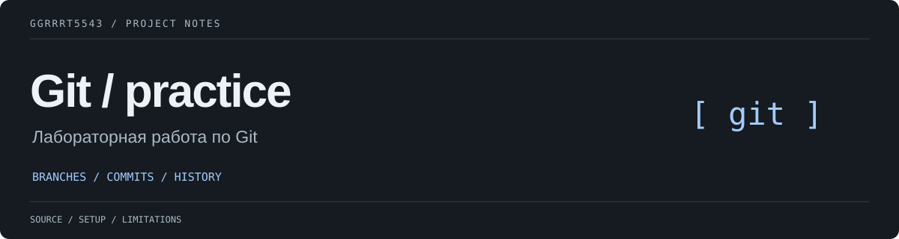

# Практика Git

Лабораторная работа по Git
Автор: Кутузов Ярослав, группа ИИС-54-15

## Материалы

- [Исходное описание работы](README.txt)
- [Задания](tasks.txt)
- [Эксперимент](experiment.txt)
- [Возможности](features.txt)

---

Автор и поддержка — [ggrrrt5543](https://github.com/ggrrrt5543). Инструкции, ограничения и сведения о сторонних компонентах приведены выше.
